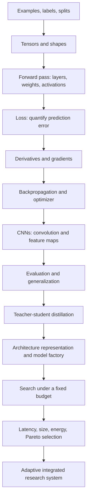

# Learning roadmap

## The dependency chain

## Five projects, five deliverables

| Project | You build | Evidence you should be able to explain |
|---|---|---|
| 1 | A CNN trained from a raw PyTorch loop | A hand-computed convolution, loss/gradient intuition, learning curves, held-out test metrics |
| 2 | Teacher, label-only student, distilled student | Logits vs probabilities, temperature, KL term, fair comparison, teacher freezing |
| 3 | Configurable model factory and evolutionary NAS baseline | Search space, candidate budget, validation-only selection, search log |
| 4 | Resource measurement, constraints, Pareto ranking | Timing protocol and limitations, objective directions, feasible Pareto set |
| 5 | Adaptive teacher-guided multi-objective search | Explicit adaptive rule, baselines, ablations, real hardware evidence or clearly stated absence |

## Suggested work rhythm

For every lesson, predict what an experiment will show before running it. Then record the observation, whether it matched the prediction, and a plausible reason. When a result surprises you, check the data split, labels, shapes, gradients, evaluation mode, and measurement protocol before redesigning the model.

Advance only when you can explain the current code without reading it line by line. Exercises are in each project’s `exercises.md`; solutions are deliberately separate. `progress.md` is a self-check, not a substitute for running the experiments.
