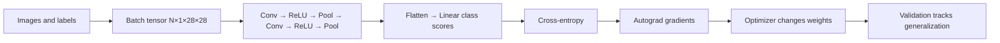

# Project 1 — Understand learning and build a CNN

**Goal:** train, inspect, save, reload, and evaluate an image classifier while understanding what each training operation does.

Start with `01-learning-and-data.md`, then `02-neurons-loss-and-gradients.md`, `03-convolution-and-cnn.md`, and `04-training-evaluation-and-experiments.md`. The runnable implementation is [`code/train_cnn.py`](code/train_cnn.py). Exercises and answers are separate in [`exercises.md`](exercises.md) and [`solutions.md`](solutions.md).

From `docs/ml-book/`, run:

```bash
python3 project-01-ml-and-cnn/code/train_cnn.py --dataset mnist --epochs 2 --batch-size 128 --train-limit 12000 --test-limit 2000
```

First run downloads MNIST. Remove limits for a fuller experiment. To use Fashion-MNIST, set `--dataset fashion`. The code creates a deterministic train/validation split from the official training set and keeps the official test set for one final report. Model and JSON log go to `artifacts/project1/` unless `--output-dir` changes it. Accuracy varies with seed, package/device, and budget; no exact score is promised.


